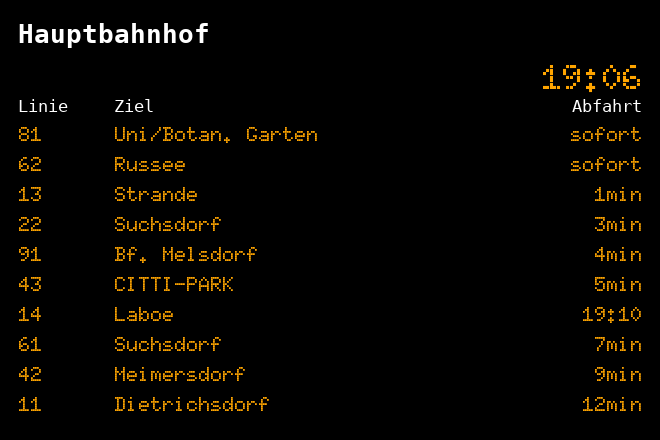

# conky-kvg – KVG-Echtzeitabfahrten als Conky-Widget

Zeigt die nächsten Busabfahrten einer KVG-Haltestelle in Kiel als Desktop-Widget (Conky) an –
optisch angelehnt an die elektronischen Anzeigetafeln (DFI) an den Haltestellen:
schwarzer (halbtransparenter) Hintergrund, Spalten `Linie | Ziel | Min`,
Liniennummern und Minuten in Amber/Orange, Uhrzeit oben rechts.

Datenquelle: inoffizielle JSON-API der KVG („internetservice“), siehe [docs/api-endpunkte.md](docs/api-endpunkte.md).



## Voraussetzungen

- Ubuntu/Debian: `sudo apt install conky-all jq curl` (`conky-all` enthält die nötige Lua-Unterstützung; prüfen mit `conky -v | grep -i lua`)
- X11-Sitzung (bei Wayland am Login „Ubuntu on Xorg“ wählen)

## Installation

```bash
mkdir -p ~/.config/conky ~/.local/bin
cp conky/conky.conf   ~/.config/conky/conky.conf
cp conky/kvg.lua      ~/.config/conky/kvg.lua
cp conky/kvg-stop.conf.example ~/.config/conky/kvg-stop.conf   # Haltestelle konfigurieren
cp bin/kvg-abfahrten.sh ~/.local/bin/kvg-abfahrten.sh   # nur Fallback ohne Lua
chmod +x ~/.local/bin/kvg-abfahrten.sh
```

Conky starten: `conky` – Konfiguration testen/neu laden mit `killall conky && conky`.

## Autostart

```bash
mkdir -p ~/.config/autostart
cat > ~/.config/autostart/conky.desktop <<'EOF'
[Desktop Entry]
Type=Application
Name=Conky
Exec=sh -c "sleep 5 && conky"
Terminal=false
X-GNOME-Autostart-enabled=true
EOF
```

Alternativ als systemd-Userdienst: `~/.config/systemd/user/conky.service` mit
`ExecStart=/usr/bin/conky`, dann `systemctl --user enable --now conky.service`.

## Haltestelle wechseln

Über die Datei **`~/.config/conky/kvg-stop.conf`** (wird beim Start aus `conky/kvg-stop.conf.example` angelegt):

```
STOP=2731
NAME=Petruskirche
```

- `STOP` = vierstellige KVG-Haltestellennummer, `NAME` = Titel oben im Widget.
- Änderung wird **ohne Conky-Neustart** übernommen (spätestens nach 30 s, wenn der API-Cache neu lädt; der Titel sofort beim nächsten Tick).
- Beide Varianten (Lua und awk-Fallback) lesen dieselbe Datei; beim Fallback ohne Lua bleibt nur der Titel statisch in `conky.text`.

Standard ist der **Hauptbahnhof (Haltestellennummer `2387`)**.

Alle Haltestellennummern für das Kieler Stadtgebiet (488 Haltestellen, Stand der Abfrage siehe CSV):
[docs/haltestellen-kiel.csv](docs/haltestellen-kiel.csv) – Spalten:
`haltestellennummer,name,interne_id,kategorie,latitude,longitude`.
Beispiele: `2387` Hauptbahnhof, `2731` Petruskirche, `3001` Hbf/Kaistraße.

Die Liste kann jederzeit neu erzeugt werden (Koordinaten = Grad × 3.600.000, Bounding-Box Kiel
ca. lat 54.26–54.42, lon 9.96–10.26):

```bash
curl -s "https://kvg-internetservice-proxy.p.networkteam.com/internetservice/geoserviceDispatcher/services/stopinfo/stops?top=195912000&bottom=195336000&left=35856000&right=36936000" \
  | jq -r '.stops[] | [.shortName, .name, .id, .category, (.latitude/3600000), (.longitude/3600000)] | @csv'
```

## Android / Smartphone (PWA)

Conky läuft nur unter Linux/X11 – auf dem Handy nimmst Du stattdessen die Web-App in `app/widget.html` (gleiche API, gleiches Design; CORS ist erlaubt, die API antwortet mit `Access-Control-Allow-Origin: *`).

1. **GitHub Pages aktivieren:** Repo → *Settings → Pages → Branch `main`, Folder `/ (root)`* → Save. Die App liegt dann unter `https://kaffeeringe.github.io/conky-kvg/app/widget.html`.

   **Schriftarten lokal gebundelt:** die PWA lädt nichts mehr von Google – in `app/fonts/` liegen `Doto-var-latin.woff2` (Doto, variable wght 100–900, latin, SIL OFL 1.1) sowie `DejaVuSansMono.ttf` / `DejaVuSansMono-Bold.ttf` (DejaVu Sans Mono, Bitstream-Vera-Lizenz) und werden per `@font-face` in `app/widget.html` eingebunden. Titel/Kopf (`#name`, `thead`) nutzen DejaVu Sans Mono, Datentabelle + Uhr Doto.
2. **Auf dem Handy:** URL im Chrome öffnen, z. B. `https://kaffeeringe.github.io/conky-kvg/app/widget.html?stop=2731&name=Petruskirche`, dann Menü (⋮) → **„Zum Startbildschirm hinzufügen“** → Icon auf dem Homescreen, öffnet als Vollbild-App (`display: standalone`) und aktualisiert alle 30 s.
3. **Haltestelle wechseln:** über die URL-Parameter `?stop=<Nummer>&name=<Name>` (Nummern siehe `docs/haltestellen-kiel.csv`); dafür einfach ein weiteres Lesezeichen/Icon mit anderem Parameter anlegen.

Alternativen: **KWGT/Kustom**-Widget (HTTP-Abruf direkt aus dem Widget via `$wg(url, jsonpath)$`), **Termux + Termux:Widget** (führt `bin/kvg-abfahrten.sh` direkt aus, Shortcut auf den Homescreen), oder fertige Apps (NAH.SH-App, mobil.kielregion.de als PWA, kiel-live).

## Anzeige anpassen

- **Schriftart Doto Black (Uhr + Bus-Tabelle):** in `conky.text` Uhr und Abfahrtsblock mit `${font Doto:size=16:weight=900}…${font}` bzw. `${font Doto:size=12:weight=900}…${font}` einklammern (falls fontconfig den Stil als eigenen Family-Namen führt, geht auch `${font 'Doto Black':size=…}`; prüfen mit `fc-list | grep -i doto`). Doto ist monospaced – die Spaltenbreiten in Zeichen (`pad(…)`) bleiben dadurch gültig. In der PWA (`app/widget.html`) wird Doto (wght 900) über Google Fonts als Standardschrift geladen. Falls die Tabelle am rechten Rand abgeschnitten wird: `minimum_width` in `conky.conf` erhöhen (Doto-Glyphen können breiter sein als DejaVu).
- **Transparenz:** in `conky.conf` `own_window_argb_value` ändern (255 = deckend, 180 = leicht transparent).
- **Farben:** `color1` (Amber, Standard `FFA500`), `default_color` (Weiß), `color2` (grau für Hinweise/Fehler).
- **DFI-Layout (an die echte Tafel angelehnt):** Uhr steht in eigener Zeile oben rechts über der Spalte „Abfahrt“ (in `conky.conf` per `${alignr}`; dafür `minimum_width` klein halten, damit die Tabellenbreite das Fenster definiert). Abfahrt-Spalte rechtsbündig (`lpad(…, 8)` in `kvg.lua`, `text-align: right` in der PWA), Format `6min` (klein, ohne Leerzeichen), bei `0min` wird `sofort` angezeigt; ohne Echtzeit (`status=PLANNED`) steht dort die Soll-Uhrzeit (`8:35`). Verspätungen landen in einer eigenen vierten Spalte **„Ist“** (grau, rechtsbündig; leer wenn pünktlich) – nicht mehr als Klammer an der Abfahrt-Spalte. In der PWA: `th/td:last-child { text-align: right }` und `sofort` im JS.
- **Lauftext-Fußzeile:** `generalAlerts` aus der API werden als scrollende Fußzeile angezeigt (Conky: `${scroll 39 …}` aus `kvg.lua`; PWA: CSS-Marquee in `app/widget.html`). Mehrere Meldungen werden mit ` +++ ` getrennt. Erscheint nur, wenn Meldungen vorliegen.
- **Mehr/weniger Zeilen:** in `kvg.lua` bzw. `kvg-abfahrten.sh` das `.actual[:20]` anpassen.
- **Linien filtern:** im jq-Filter z. B. `select(.patternText == "6" or .patternText == "91")` ergänzen.
- **Spaltenbreite:** `pad(…, 5)` / `pad(…, 24)` in `kvg.lua` bzw. `%-5s` / `%-24s` in awk – Überschrift und Datenzeilen müssen identische Breiten haben. `pad()` zählt sichtbare Zeichen (UTF-8), damit Umlaute (z. B. „Reventloubrücke“) die Spalte nicht verschieben.
- **Fallback ohne Lua** (`conky-std`): in `conky.text` statt `${lua_parse kvg_abfahrten}` nutzen:
  ```
  ${color1}Hauptbahnhof${color}${alignr}${color1}${time %H:%M}${color}   # Titel hier manuell anpassen
  ${color1}${execi 30 /home/DEINUSER/.local/bin/kvg-abfahrten.sh}${color}
  ```

## Hinweise

- **Flackern:** in `conky.conf` ist `double_buffer = true` gesetzt – Conky zeichnet dann zuerst off-screen und tauscht das Bild atomar aus, statt sichtbar neu zu malen. Falls es trotzdem flackert: Compositor aktivieren (GNOME/KDE: standardmäßig an) bzw. `update_interval` erhöhen (z. B. `5.0`; die Uhr oben aktualiert sich dann seltener, die API-Daten sowieso nur alle 30 s via Cache).
- Die API ist **inoffiziell** (kein API-Key, keine Doku, kann sich ändern). Abruf max. alle 30 s – in `kvg.lua` ist das bereits eingebaut (Caching über `os.time()`, `CACHE_SECONDS = 30`); die awk-Fallback-Variante nutzt `execi 30`.
- `mixedTime` enthält den Platzhalter `%UNIT_MIN%` (→ „Min“ ersetzen); bei `status=PLANNED` steht dort stattdessen die Uhrzeit.
- Verspätung: `actualTime` weicht von `plannedTime` ab – das Widget zeigt die Ist-Uhrzeit dann grau in Klammern an.
- Am Hauptbahnhof fahren viele Linien takt-synchron zur selben Minute (Taktknoten) – gleiche Minutenangaben in mehreren Zeilen sind korrekt, siehe dazu mehr Zeilen via `.actual[:20]`.

## Lizenz

[GPL-3.0](LICENSE) (vom Repo-Initialcommit übernommen)
